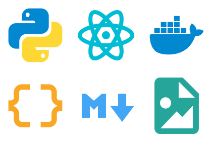

# Material Icon Pack for One Commander

A Material Design icon pack for [One Commander](https://onecommander.com/), generated from
[`material-extensions/vscode-material-icon-theme`](https://github.com/material-extensions/vscode-material-icon-theme).

One Commander resolves file icons by **extension lists embedded in the file name**
(`py,pyw.png`) and folder icons by **real folder names** (`src.png`). This project rewrites
the Material Icon Theme associations into exactly that layout and renders every icon at
512×512 from the upstream SVG sources.



## What is inside

| | |
| --- | --- |
| Upstream | `vscode-material-icon-theme` **v5.39.0** (pinned in `upstream.lock.json`) |
| File icons | **403** PNGs covering **1308** extensions / file tokens (380 Material icons) |
| Folder icons | **925** PNGs for 264 Material folder icons |
| Size | 512×512 RGBA, plus two 420×280 `Thumbnail.png` previews |
| Build deps | Python 3.10+ (standard library) and Inkscape 1.x for rendering |
| Download | ~10 MB zip from the [releases page](../../releases) |

## Install

### From a release (recommended)

1. Download `MaterialIconTheme-1.0.0.zip` from the [releases page](../../releases) and
   extract it.
2. Copy the two pack folders into One Commander:
   - `FileIcons\MaterialIconTheme` → `<OneCommander>\Resources\FileIcons\`
   - `FolderIcons\MaterialIconTheme` → `<OneCommander>\Resources\FolderIcons\`
3. Restart One Commander, open **Settings → Theme** and select `MaterialIconTheme` for both
   *File icons pack* and *Folder icon pack*.

Where is `<OneCommander>`?

| Install type | Path |
| --- | --- |
| MSI installer | `%LOCALAPPDATA%\OneCommander` |
| Portable | the extracted `OneCommander` folder |
| Microsoft Store | **About → Settings Location** shows the data directory |

If the dropdown does not list the pack immediately, close and reopen the Settings dialog.

### With PowerShell

```powershell
# from a checkout (or after extracting the release zip next to the scripts)
.\scripts\install.ps1                       # MSI install
.\scripts\install.ps1 -Target D:\Apps\OneCommander
.\scripts\install.ps1 -DryRun               # show what would happen
```

A previously installed `MaterialIconTheme` is moved to `MaterialIconTheme.bak`; the
uninstaller restores it:

```powershell
.\scripts\uninstall.ps1
```

## Build from source

```bash
git clone https://github.com/<your-org>/one-commander-material-icon-pack.git
cd one-commander-material-icon-pack

make check     # validate mappings/ against pack/ and the vendored upstream (seconds)
make build     # re-render all 1328 PNGs into pack/ (needs Inkscape)
make verify    # sizes, file names, thumbnails, mapping ↔ file consistency
make dist      # build + dist/MaterialIconTheme-<version>.zip
```

`make help` lists every target. The vendored upstream checkout in
`vendor/material-icon-theme/` (SVGs, the two TypeScript definition files and
`package.json`) makes the build fully offline; `make vendor` refreshes it from the tag in
`upstream.lock.json`.

Without Inkscape you can reuse the PNGs that ship with the upstream project:

```bash
python3 scripts/build.py --renderer copy --size 512
```

## How the naming works

### File icons

- Every Material icon collects the extensions it should cover and One Commander gets one
  PNG whose name is the comma-joined list: `py,pyw.png`, `ts,tsx.png`.
- Dot-files are claimed first (`gitignore` from `.gitignore`), then extensions in
  definition order, so a token belongs to exactly one icon.
- Names longer than 100 characters are split into several identically rendered files
  (One Commander's filename limit).
- Tokens that would collide with Windows device names (`con`, `nul`, `com1` …) are skipped.

### Folder icons

- `folder-src` → `src.png`: the icon that matches its own folder name wins first.
- Remaining aliases are claimed in definition order (`folder-vuex-store` → `stores.png`).

Both tables are generated deterministically; `mappings/file-icons.tsv` and
`mappings/folder-icons.tsv` are committed so every change is reviewable in a diff. See
[docs/mappings.md](docs/mappings.md) and [docs/one-commander.md](docs/one-commander.md).

## Repository layout

```
├── docs/                     # mapping + One Commander notes, README preview
├── mappings/                 # generated, committed mapping tables (TSV)
├── pack/                     # generated icon packs (committed, copy-ready)
│   ├── FileIcons/MaterialIconTheme/
│   └── FolderIcons/MaterialIconTheme/
├── scripts/                  # build.py, verify.py, package.sh, install/uninstall.ps1, …
├── vendor/material-icon-theme/  # pinned upstream subset (SVGs + TS definitions)
├── .github/workflows/        # CI (check + verify) and release (tag -> zip)
├── dist/                     # build manifest and zip (not committed)
└── Makefile
```

## Updating the pinned upstream

```bash
# bump "tag"/"version" in upstream.lock.json first
make vendor
make check      # shows what changed in the mapping tables
make build
make verify
make dist
```

## Skipped icons

Icons that only exist as generated clones in the upstream build (`nest-*`, `angular-*`,
`advpl-*`, …) have no source SVG here and are skipped; the build manifest lists them under
`skipped`. The same goes for icons without a usable extension or folder-name token.

## License

MIT, see [LICENSE](LICENSE). The artwork is derived from the Material Icon Theme by Material
Extensions; see [ATTRIBUTION.md](ATTRIBUTION.md).

---

[中文说明](README.zh-CN.md)
